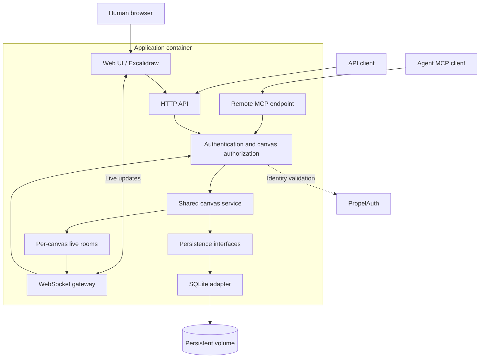
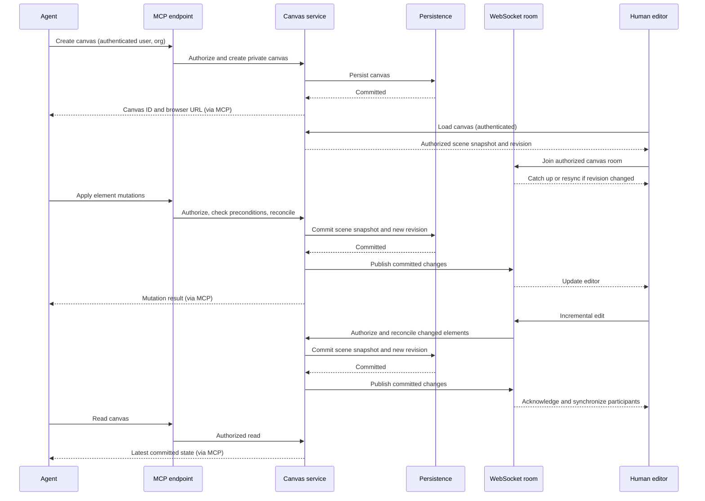
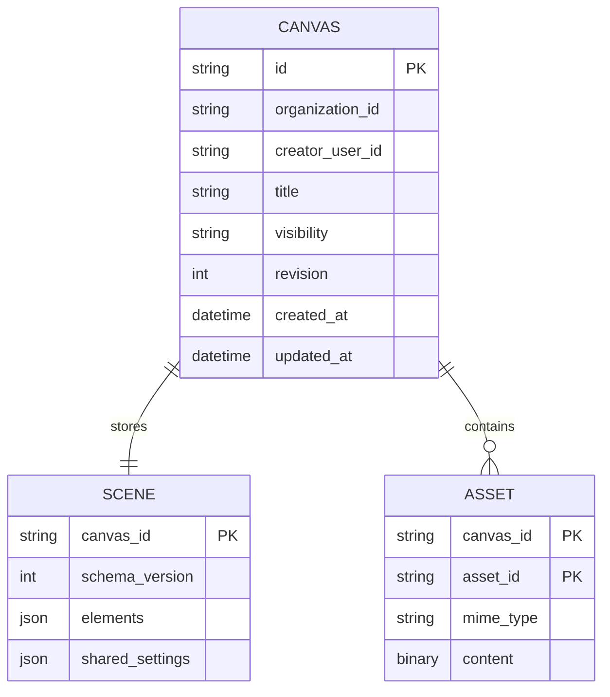

# Excalibur: high-level design

## Goal

Excalibur is a deployable Excalidraw service for humans and agents. Humans use a web UI; agents use an authenticated remote MCP server. Both work on the same persistent canvases, with live updates from the start.

The service ships as a container image. The first version runs as one application instance, with SQLite on a persistent volume and PropelAuth as the external identity provider.

## Initial scope

- PropelAuth authentication for the web UI, HTTP API, and MCP endpoint.
- Organization-owned canvases that default to private visibility.
- A UI for creating, browsing, and editing canvases.
- An MCP interface for creating, reading, and editing canvases.
- Live human–agent and human–human editing.
- Durable storage, including scene elements and image assets.
- Stable canvas IDs and browser URLs.
- New canvases per agent session by default, with the ability to reopen existing canvases by ID or URL.

A canvas survives the agent session that created it. An MCP transport session is not the canvas identity, and reconnecting must not automatically create a duplicate canvas.

## Ownership and permissions

Every canvas records a PropelAuth organization ID, a creator user ID, and a visibility value: `private` or `organization`.

| Action | Creator | Other current organization member |
| --- | --- | --- |
| View or edit a private canvas | Yes | No |
| View or edit an organization-visible canvas | Yes | Yes |
| Change visibility | Yes | No |
| Delete the canvas | Yes | No |

All access requires authentication and current membership in the canvas's organization, including access by the creator. There are no public links, per-user sharing lists, or viewer/editor roles in the initial version.

Agents act on behalf of a PropelAuth-authenticated user. A canvas created through MCP has that user as its creator; agents do not have separate service identities.

New requests and reconnects enforce current permissions. Immediately disconnecting other users when a canvas becomes private is not required initially. Existing authorized live connections may retain their access until disconnected; this is a deliberate initial limitation.

## Architecture

### Web UI

The browser hosts the Excalidraw editor, a canvas list, and canvas creation and visibility controls. The canvas list includes the user's private canvases and organization-visible canvases in the selected organization. A sole membership opens automatically; multiple memberships show a picker. Selection is remembered per user and tab and revalidated on load. Every browser API request validates the selected organization against current membership. Accounts with zero memberships cannot access canvases. Switching organizations navigates to a fresh canvas list, closes the previous live connection, and retains the editor's unsaved-change prompt.

The editor loads a canvas snapshot, joins its live room, and sends incremental edits. Viewport, selection, and other local editor state should remain local unless explicitly introduced as a collaboration feature.

### Shared canvas service

The shared canvas service is the authoritative application layer for reads and mutations. HTTP, MCP, and WebSocket handlers call this layer rather than implementing separate drawing or permission rules.

Every operation carries an authenticated user, organization context, and explicit canvas ID. Organization IDs and user IDs supplied by clients are not trusted without validating membership and permissions.

Creator-only visibility changes are implemented through the Share dialog, `PATCH /api/canvases/:id/visibility`, and the `set_canvas_visibility` MCP tool. They require the previous visibility as an optimistic precondition; already-current retries are idempotent. Changes persist atomically and advance the canvas revision without replacing the scene or assets. Live clients receive an empty scene update for that revision followed by updated canvas metadata, so sharing changes cannot cause a missed drawing revision or reset the editor.

Creator-only rename and deletion use the canvas actions menu, `PATCH` and `DELETE /api/canvases/:id`, and the `rename_canvas` / `delete_canvas` MCP tools. Renaming requires the previous title, advances the canvas revision, and uses the same metadata broadcast path as sharing. Deletion requires the exact current title and canvas revision. It atomically cascades to assets and comments, notifies and closes all live connections, and clears process-local canvas subscriptions and editor selections. Conflicts require review and explicit confirmation again. Other open browsers retain unsaved drawing state for export instead of redirecting or reconnecting automatically.

The service manages scene mutations, revisions, persistence, and publication of committed changes to the appropriate live room. No canvas state or broadcast channel is global across users or canvases.

### Remote MCP endpoint

The MCP server is available over HTTP rather than requiring a local stdio process. Authentication uses a user authorization flow backed by PropelAuth; agents should never receive the user's password.

The MCP resource is the canonical application origin plus `/mcp`. Public protected-resource metadata advertises PropelAuth's `/oauth/2.1` authorization server and the required `canvases:access` organization scope. PropelAuth handles client registration, login/consent, organization selection and token issuance; Excalibur validates access tokens through MCP Request Validation introspection and checks current account eligibility and org membership. Browser login alone does not establish MCP authentication.

Each MCP authorization is bound to exactly one organization through the validated token's `org_id`. Users may have multiple memberships; the selected membership must still exist. Missing org claims or the required scope fail closed, even for single-org users. MCP organization changes require reauthorization; browser selection, headers and tools cannot override the token. See the README for dashboard configuration and real-client acceptance checks. The automated suite covers the selected SDK's OAuth flow with a simulated issuer; real hosted consent must also be verified for the target client.

MCP requests carry or resolve an explicit canvas ID. Tools must not depend on a process-global “current canvas.” Creating a canvas returns its ID and browser URL. Reopening by URL resolves the canvas identity and performs the same authorization checks as reopening by ID.

### Live collaboration

Browsers connect to authenticated, canvas-scoped WebSocket rooms. MCP edits enter through normal tool calls and are broadcast to connected browsers after being committed. Agents can read the latest canvas state through MCP; proactive MCP change notifications are not required for the first version.

WebSockets provide transport, not conflict resolution. Use server-authoritative scene state and incremental element updates, following native Excalidraw reconciliation semantics where practical:

- Serialize accepted mutations within each canvas.
- Preserve native element `version`, `versionNonce`, `isDeleted` tombstones, and fractional ordering indices.
- Reconcile changed elements against the authoritative scene rather than accepting a stale full-scene replacement. Native reconciliation resolves same-element conflicts deterministically; it does not merge every property or text edit.
- Track a monotonic server canvas revision separately from native element versions. MCP read–modify–write commands can use revision preconditions and return conflicts for refresh and retry.
- Persist the resulting scene snapshot atomically, rather than recording each drawing action in an operation log.
- Commit before acknowledging success or publishing durable scene changes.
- On reconnect, reload the authoritative scene and reconcile or reject pending local edits explicitly.

The precise mutation schema and same-element conflict behavior need a small collaboration prototype against the pinned SDK version before being treated as finalized. Validate active human edits, bindings, ordering, undo, and reconnects. This design does not assume that Excalidraw's component alone supplies a collaboration backend.

Joining a room and loading a snapshot must account for changes between the two operations. Clients must never miss an update simply because it arrived during initial loading.

## Persistence boundary

SQLite is the initial implementation, not an application-wide dependency. Domain-oriented persistence interfaces cover:

- Canvas metadata, visibility, listing, and deletion.
- Scene snapshot loading and atomic snapshot commits.
- Server revision checks.
- Image asset storage and retrieval.

Keep transaction boundaries explicit: saving a scene and advancing its server revision must be atomic. Application code should not depend on SQLite SQL syntax, driver types, or filesystem paths.

Incremental network updates and snapshot persistence are independent choices. Store the current scene, not an event-sourced history. Per-element SQL rows and a permanent operation log are not initial requirements. If durable retry deduplication becomes necessary, add a bounded request ledger behind the persistence interface; do not use it as the source of canvas state.

An initial logical data model is:

This is a logical model, not a finalized SQL schema. The scene may also live directly on the canvas row initially. Store native Excalidraw element arrays, preserving fields, bindings, ordering, and deletion tombstones. Persist only explicitly shared document settings, not the entire user's editor state. Keep image bytes separate and authorize asset access through the owning canvas, not unprotected static URLs.

The SDK's scene format contains `elements`, `appState`, and `files`; it does not prescribe a database schema. Excalidraw's open-source collaboration app persists scene element arrays and stores image assets separately. Its reconciliation uses element versions and deterministic tie-breaking rather than replaying an operation history. References: [scene format](https://docs.excalidraw.com/docs/codebase/json-schema), [upstream persistence](https://github.com/excalidraw/excalidraw/blob/master/excalidraw-app/data/firebase.ts), and [reconciliation](https://github.com/excalidraw/excalidraw/blob/master/packages/excalidraw/data/reconcile.ts).

Use versioned database migrations from the start. A PostgreSQL adapter should later replace SQLite without changing transport handlers or canvas logic, but still requires schema and data migration. Multiple application replicas also require cross-instance room coordination and event distribution; replacing the database alone does not provide this.

## MCP tool direction

Use `/Users/michael.rose/Software/private/mcp_excalidraw` as an implementation reference, especially:

- `src/core/mcp-tools.ts`: tool definitions and agent-friendly inputs.
- `src/core/mcp-server.ts`: protocol registration separated from tool dispatch.
- Drawing normalization, label sizing, and arrow binding helpers in `src/core/`.
- `src/core/render/`: headless scene rendering.
- `frontend/src/App.tsx` and `src/server.ts`: examples of editor integration and live event transport.

The initial tool surface should prioritize:

| Capability | Examples |
| --- | --- |
| Canvas lifecycle | Create, list, get, change visibility, delete |
| Read and inspect | Read scene, query elements, describe scene |
| Edit | Create, update, delete, atomic batch mutations |
| Visual feedback | Render a canvas or element subset to PNG/SVG |

Layout helpers, Mermaid conversion, import/export, and named snapshots are useful follow-ups; their inclusion in the reference project does not automatically make them initial requirements.

Headless rendering is particularly valuable because agents should be able to inspect canvases without a human keeping a browser tab open. Any reused code must retain applicable license notices.

Do not carry over the reference project's global canvas state, broadcast-to-all client set, unauthenticated endpoints, or full-scene overwrite synchronization. Its external excalidraw.com sharing feature is also not this service's organization visibility model.

## Deployment and operations

- Ship one application image containing the web assets and server.
- Mount a persistent data directory for SQLite and any filesystem-backed assets.
- Configure PropelAuth, the public application URL, and runtime settings through environment variables or injected secrets.
- Terminate HTTPS at the application or a trusted reverse proxy with WebSocket support.
- Provide liveness/readiness endpoints and graceful shutdown.
- Apply database migrations through a documented startup/deployment procedure.
- Document backup and restore for the database and assets as one consistent dataset.
- Supply a basic Docker Compose setup for local development and self-hosting.

Authentication and canvas authorization must cover all routes, rendering, asset access, and WebSocket upgrades. Include origin validation, input and payload limits, and safe handling of tokens in logs. Do not put long-lived bearer tokens in WebSocket URLs.

## Deferred decisions and non-goals

Not required initially:

- Multiple application replicas or distributed collaboration rooms.
- Public or anonymous canvas access.
- Per-user sharing, read-only roles, or separate agent identities.
- Immediate revocation of existing live connections.
- Offline-first collaboration or automatic merging of every same-element conflict.
- Proactive canvas-change subscriptions over MCP.

Before implementation, validate:

1. The remote MCP authentication flow supported by PropelAuth and target clients.
2. Excalidraw integration, mutation granularity, conflict handling, and reconnect behavior.
3. The backend/frontend framework choices and MCP SDK version.
4. Initial asset limits and rendering resource limits.
5. Each browser workspace and MCP authorization uses one selected organization; users may belong to multiple organizations.
